# `unmbt/moon-taze` Architecture & Design

This document describes the architecture, invariants, and contracts of `unmbt/moon-taze` on MoonBit `v1.0.0-rc1`.

## 1. Layered Architecture

```mermaid
flowchart TD
    CLI["cmd/moon-taze (@cac CLI)"]
    CLI --> Disc["discovery.mbt (moon.mod / moon.work / GHA YAML)"]
    CLI --> Cache["cache.mbt (cache-v2.json: Mooncakes + GitHub)"]
    CLI --> Render["render.mbt (Text / JSON v1 / Sort / Age / Timediff)"]
    CLI --> Verify["verify.mbt (moon check via @process.run)"]

    CLI --> Core["unmbt/moon-taze (Root Library)"]

    subgraph CorePkg ["unmbt/moon-taze Core Library"]
        Model["model.mbt · semver.mbt · selector.mbt · time.mbt"]
        Config["config.mbt · workspace.mbt"]
        MM["manifest_moon.mbt (delegates to unmbt/moon-manifest)"]
        MG["manifest_gha.mbt (zero-dep lossless YAML scanner)"]
        RM["registry_mooncakes.mbt (Mooncakes HTTP + retry)"]
        RG["registry_github.mbt (GitHub Tags/Commits API + token)"]
        Res["resolver.mbt (pure resolve + unified check engine)"]
        App["apply.mbt · write_native.mbt/.c (lock · snapshot · atomic replace)"]
    end

    MM --> MoonManifest["unmbt/moon-manifest"]
    CLI --> Cac["unmbt/cac"]
    RM --> CoreAsync["moonbitlang/core/async (http · fs · process · stdio)"]
    RG --> CoreAsync
    App --> CoreAsync
```

### Design Principles

1. **Zero fragile third-party dependencies**: Depends only on `unmbt/moon-manifest`, `unmbt/cac`, and `moonbitlang/core` (including `moonbitlang/core/async`).
2. **Separation of checking and writing**: `check` / `check_manifests` build an immutable in-memory `CheckPlan` holding authoritative UTF-8 byte snapshots; `apply` accepts a `Selection` strictly bound to that live plan.
3. **Byte-for-byte lossless edits**: Neither `moon.mod` nor GitHub Actions YAML files are re-serialized. Only the exact UTF-8 byte spans of updated versions/refs (and SHA version comments) are replaced — preserving BOM, CRLF/LF, comments, quotes, indentation, and trailing newlines.
4. **Deterministic & testable core**: `resolve` is pure and IO-free; `check` and `check_manifests` accept injectable async fetch closures (`fetch` and `fetch_gha`) for fast offline testing.

---

## 2. Manifest Adapters

### MoonBit (`manifest_moon.mbt` + `workspace.mbt`)
- Delegates parsing and lossless multi-span version edits to [`unmbt/moon-manifest`](https://github.com/unmbt/moon-manifest) (backed by official `moonbitlang/moon_config`).
- Rejects legacy `moon.mod.json` explicitly (`unsupported_manifest`) and flags mixed `moon.mod` + `moon.mod.json` directories (`ambiguous_manifest`).
- Reads `moon.work` explicit `members` arrays; marks intra-workspace references as `LocalWorkspace` (`local_workspace`) without hitting Mooncakes.

### GitHub Actions (`manifest_gha.mbt`)
- Discovers `.github/workflows/*.{yml,yaml}`, `.github/actions/**/action.{yml,yaml}`, and `action.{yml,yaml}` (enabled by default; disable with `--no-github-actions` or `moon-taze.json`).
- Zero-dependency lossless YAML scanner extracts `uses:` entries from block mappings, sequence items (`- uses: ...`), and flow mappings (`{ uses: ... }`), while skipping YAML comments and block scalars (`run: |`, `>`) so embedded scripts are never misread.
- Supports tag references (`actions/checkout@v4`), subpaths (`actions/cache/restore@v4.0.0`), and 40-char commit SHA pins with trailing version comments (`actions/checkout@<sha> # v4.1.6`). Skips local (`./...`), Docker (`docker://...`), branch (`@main`), and uncommented SHA refs.
- Write styles (`--github-actions-style auto | tag | sha`):
  - `auto` (default): preserves each reference's existing style (`tag` stays `tag`; `sha` updates both SHA and `# <tag>`).
  - `tag`: writes tag references and removes stale SHA version comments.
  - `sha`: writes 40-char commit SHA + ` # <tag>`, and pins up-to-date tag references with `DiffKind::Pin`.

---

## 3. Registries, Caching & Resolution

### Mooncakes (`registry_mooncakes.mbt`)
- Queries `GET /api/v0/modules/<encoded>` and (when release times/ages/timediff/maturity are needed) `GET /api/v0/modules/<encoded>%40<version>`.
- Validates module identity, version uniqueness, SemVer 2.0.0 syntax, `yanked` status, and `latest_version` integrity before results enter resolution or disk cache.

### GitHub API (`registry_github.mbt`)
- Auth token fallback order: `GITHUB_TOKEN` -> `GH_TOKEN` -> `gh auth token` (cached once per process) -> unauthenticated.
- Paginates `GET /repos/{owner}/{repo}/tags?per_page=100&page={p}` (up to 10 pages), keeping `v<major>[.<minor>[.<patch>]]` tags and their commit SHAs.
- Fetches `GET /repos/{owner}/{repo}/commits/{sha}` on demand for maturity-period or time-diff evaluation.
- Recognizes `403` with `x-ratelimit-remaining: 0` as `rate_limited`, and applies bounded exponential backoff (with `Retry-After` support) via shared `retry_registry`.

### Update Modes & Granularity
- **MoonBit**: Full SemVer 2.0.0 comparison supporting `default`, `minor`, `patch`, `major`, `latest`, `stable`, `newest`, and `next`, respecting `0.x` caret boundaries, `yanked` exclusion, maturity cooldown (`--maturity-period`), and name/version selectors (`-n` / `-x`).
- **GitHub Actions**: Preserves tag precision (`v4` → `v5`, `v4.1` → `v4.2`, `v4.1.1` → `v4.2.0`), falling back to the concrete resolved tag when the moving major/minor tag does not exist.

### Persistent Cache (`cmd/moon-taze/cache.mbt`)
- Stored in the user cache directory as `moon-taze/cache-v2.json` with 30-minute TTL, namespaced by ecosystem (`mooncakes|...` and `gha|...`).
- Written via exclusive temp-file creation + atomic rename; corrupt or expired caches gracefully fall back to network fetches.

---

## 4. Atomic Write Engine (`apply.mbt` + `write_native.mbt/.c`)

1. **Pre-IO validation**: Rejects plans with errors, cross-plan selections, invalid/downgrade targets, or overlapping spans before touching the filesystem.
2. **Reparse assertion**: Patches are generated in memory (`@moon_manifest.Document::replace_dependency_versions` or `patch_gha_manifest`) and reparsed to guarantee untouched declarations remain unchanged.
3. **Locking & ownership**: Acquires an exclusive sidecar lock (`<manifest>.moon-taze.lock`), verifies file identity (inode/dev on POSIX, volume serial + file index on Windows), and refuses to overwrite symlinks or read-only files.
4. **Snapshot verification**: Re-reads original bytes right before staging and right before commit; aborts with `stale_plan` if external edits occurred.
5. **Atomic commit**: Copies permissions/DACLs to a same-directory temp file, syncs to disk, and performs atomic replacement (`rename` on POSIX, `SetFileInformationByHandle(FileRenameInfoEx)` with POSIX semantics on Windows — no delete-before-write fallback).
6. **Cancellation & partial reporting**: Cleanup runs under `@async.protect_from_cancel`. Failures report exact per-file `Written` / `Unchanged` / `Failed` / `NotAttempted` statuses without silent rollback.

---

## 5. CLI Contract (`cmd/moon-taze`)

- Built with [`unmbt/cac`](https://github.com/unmbt/cac) using `parse(argv~, run=false)` for pure, side-effect-free parsing in `async fn main` and unit tests.
- Precedence: **CLI flags > `moon-taze.json` > built-in defaults**.
- **Interactive mode (`-I` / `--interactive`)**: Powered by [`unmbt/clack`](https://github.com/unmbt/clack) (`BodyView::CustomLines`, `run_prompt`, and `confirm`) with 1:1 upstream `taze` table layout, Space/a/i toggling, `→` per-dependency version picker (including unchecked `NoCandidate` major updates and on-demand release age fetching), and post-selection write + `moon check` confirmation prompts. Requires an interactive TTY in text mode (`not_interactive`, exit code `2` otherwise); ignored in `--json` mode.
- **Exit codes**:
  - `0`: Success (or cancelled before any commit).
  - `1`: Outdated dependencies found with `--fail-on-outdated` and no errors.
  - `2`: CLI error, unsupported/not-implemented feature, parse/registry/apply error, or failed `--verify`.
